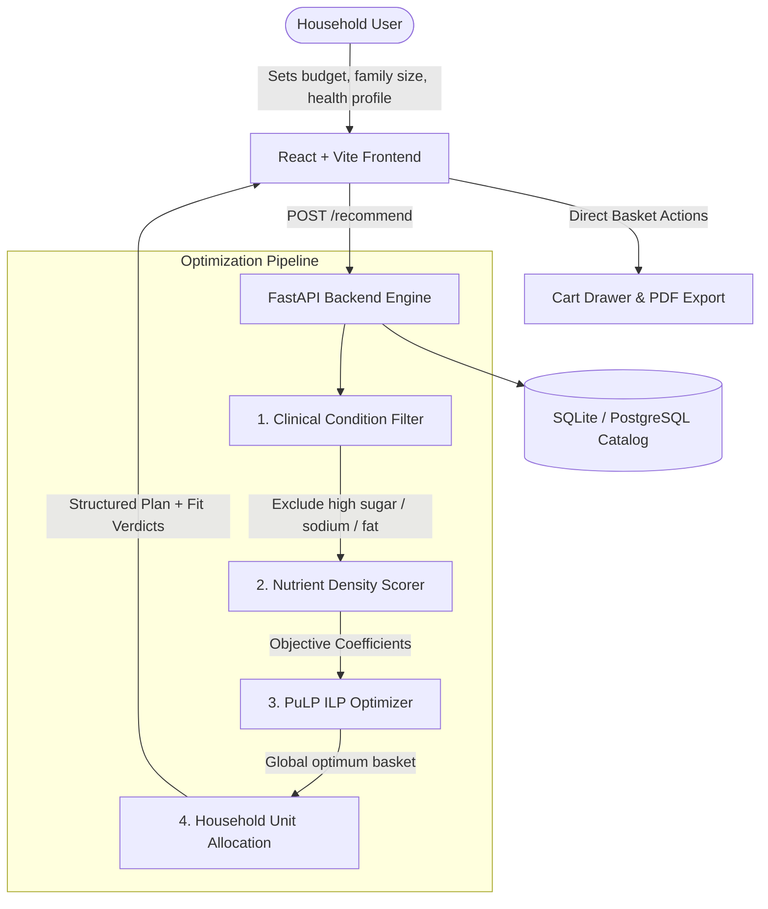

# 🛒 NutriKart — Health-Aware Grocery Planner & Budget Optimizer

NutriKart is a full-stack grocery planning application that helps households maximize nutrition within their weekly food budgets while strictly adhering to dietary health conditions (such as diabetes, hypertension, or weight management).

Instead of greedy heuristics or simple filtering, NutriKart models grocery selection as an **Integer Linear Programming (ILP)** knapsack problem solved via `PuLP` and `CBC`, ensuring mathematically optimal nutrient density under tight financial ceilings.

---

## ⚡ Highlights

* **Clinical Condition Filters**: Strict, non-negotiable dietary boundaries derived from ICMR-NIN & WHO nutrition guidelines (e.g. sugar ceiling for diabetics, sodium and fat ceilings for hypertension).
* **Mathematical Optimization**: Integer Linear Programming solves for the optimal combination of whole foods and staples that maximizes positive nutrient density (protein, dietary fiber) while penalizing excessive sugar, sodium, and saturated fats.
* **Organic Design System**: Built with React 19, Vite, and Tailwind CSS, featuring an accessible, warm palette, keyboard-navigable controls, WCAG AA contrast, and responsive viewports from mobile (375px) to desktop (1440px).
* **Pure Basket & Client PDF Export**: Interactive cart management with instant clear and undo recovery, quantity stepping, and client-side PDF generation for offline grocery shopping.
* **Provider Boundary & Offline Resilience**: Decoupled provider architecture with a verified local Indian market catalog baseline and fallback adapters.

---

## 🏗️ System Architecture



---

## 🚀 Quickstart

### Prerequisites
* Python 3.12+
* Node.js 18+ & npm
* Git

### 1. Backend Setup

```bash
cd backend

# Create and activate virtual environment
python3 -m venv venv
source venv/bin/activate    # On Windows: venv\Scripts\activate

# Install dependencies
pip install -r requirements.txt

# Run database migrations and seed baseline catalog
python scripts/seed_demo_data.py

# Start development API server
uvicorn app.main:app --reload --port 8000
```
The FastAPI backend will be live at `http://127.0.0.1:8000` with interactive API docs at `http://127.0.0.1:8000/docs`.

### 2. Frontend Setup

In a separate terminal:

```bash
cd frontend

# Install dependencies
npm install

# Start Vite development server
npm run dev
```
The frontend application will be running at `http://localhost:5173`.

---

## 🧪 Running Tests

Both backend and frontend are covered by extensive automated unit, integration, and performance test suites.

### Backend Tests (pytest)
```bash
cd backend
./venv/bin/pytest -v
```

### Frontend Tests (vitest)
```bash
cd frontend
npm test
```

### Production Build Verification
```bash
cd frontend
npm run build
```

---

## 📡 API Overview

| Method | Endpoint | Description |
| :--- | :--- | :--- |
| `GET` | `/health` | Service health status and database connectivity check |
| `POST` | `/recommend/` | Solves for optimal grocery basket based on budget, family size, and health condition |
| `GET` | `/products/` | Lists catalogue products, with optional `category_id` filtering |
| `GET` | `/products/{id}` | Fetches individual product details and nutritional breakdown |
| `GET` | `/categories/` | Lists product categories |
| `GET` | `/profile/rules` | Returns active nutritional limits and scoring weights per condition |
| `GET` | `/location/serviceability` | Checks quick-commerce service availability |

---

## 📄 License

MIT License. Designed and engineered for transparent, accessible household nutrition planning.
