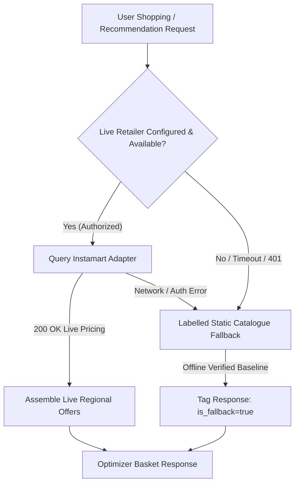

# NutriKart Upgrade 2: Access Spike & Retailer Integration Status

**Phase Context:** Verified data foundation and access spike  
**Evaluation Date:** 9 April 2026  
**Auditor:** Architecture Review  

---

## 1. Quick-Commerce Provider Access Assessment

### 1.1 Current Authentication Status
- **Provider Assessed**: Swiggy Instamart (and equivalent quick-commerce providers).
- **Access Status**: **NOT CONFIGURED / PENDING PARTNER AUTHORIZATION**.
- **Evidence**:
  - No partner developer keys or OAuth client secrets are present in `.env` or application config.
  - Developer portal onboarding requires business registration, developer account review, and enterprise approval.

### 1.2 Access Guardrails & Anti-Scraping Policy
> [!IMPORTANT]
> The project adheres to strict ethical and legal data guidelines:
> - **No Unsanctioned Scraping**: Reverse-engineering undocumented mobile APIs or running headless scrapers against consumer portals (Swiggy, Blinkit, Zepto) is strictly prohibited.
> - **Attribution & Rights**: Verified nutrition data is sourced from open licensed databases (Open Food Facts under ODbL) or permitted manufacturer packaging.

---

## 2. Mandatory Dual-Mode Architecture

Because live retailer API access is a third-party dependency, the application architecture must never be blocked by external delays.

### 2.1 The Labelled Static Fallback Contract
1. Every product in `data/verified_manifest.json` provides an authentic, verified price and macro profile.
2. If live regional access is disabled or unreachable, the system automatically runs against the static catalogue.
3. The API and UI explicitly display data freshness and fallback mode:
   - Live: `"source": "instamart_live"`, `"freshness": "live_current"`
   - Fallback: `"source": "static_catalogue"`, `"is_fallback": true`, `"notice": "Showing verified static catalogue (regional live stock unconfigured)"`

### 2.2 Next Steps for Live Enablement
When official provider credentials become available:
1. Configure credentials securely via environment variables (`INSTAMART_API_KEY`, `INSTAMART_PARTNER_ID`).
2. Run an isolated read-only staging smoke test against a user-selected pin code.
3. Gate 5 will verify live vs static fallback behavior before production release.
