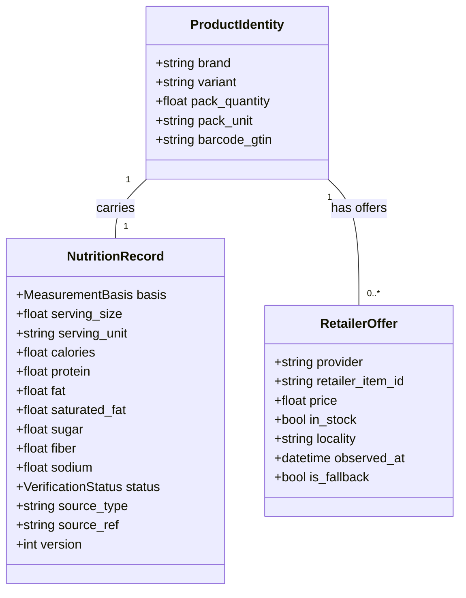

# NutriKart Upgrade 2: Data Contracts & Unit Specifications

**Phase Context:** Verified data foundation and access spike  
**Status:** Approved Specification  
**Authors:** Architecture & Data Engineering  

---

## 1. Domain Entities & Contract Definitions

To decouple stable nutritional truth from dynamic regional store offerings, the system separates three distinct entities:

### 1.1 ProductIdentity
Identifies a distinct packaged retail consumer good:
- `brand` (string, required): Brand owner (e.g. `"Saffola"`, `"Quaker"`, `"Amul"`).
- `variant` (string, required): Specific product flavor, cut, or formulation (e.g. `"Classic Masala Instant Oats"`, `"Taaza Homogenised Toned Milk"`).
- `pack_quantity` (float, required): Net content quantity in the retail packaging (e.g. `225`, `1`).
- `pack_unit` (string, required): Package measurement unit (`"g"`, `"ml"`, `"kg"`, `"l"`, `"piece"`).
- `barcode_gtin` (string, optional): 13-digit EAN/GTIN barcode where verified.

### 1.2 NutritionRecord
Represents the verified macro- and micronutrient profile:
- `basis` (enum, required):
  - `PER_100G`: Value stated per 100 grams of edible product.
  - `PER_100ML`: Value stated per 100 millilitres (liquids/beverages).
  - `PER_SERVING`: Value stated per manufacturer-recommended serving.
- `serving_size` (float, optional): Net amount per recommended portion.
- `serving_unit` (string, optional): Portion unit (`"g"`, `"ml"`, `"piece"`).
- `calories` (float, required): Energy in kilocalories (kcal).
- `protein` (float, required): Protein in grams (g).
- `fat` (float, required): Total fat in grams (g).
- `saturated_fat` (float, required): Saturated fat in grams (g).
- `sugar` (float, required): Total sugar in grams (g).
- `added_sugar` (float, optional): Added refined sugars in grams (g).
- `fiber` (float, required): Dietary fiber in grams (g).
- `sodium` (float, required): Sodium in milligrams (mg).
- `verification_status` (enum, required):
  - `VERIFIED`: Proven with matching manufacturer label or authenticated record.
  - `PENDING_REVIEW`: Candidate values parsed but awaiting human confirmation.
  - `UNVERIFIED_UNKNOWN`: Incomplete or missing data; ineligible for medical filter verification.
  - `REJECTED`: Conflicting or disproven records.
- `source_type` (string, required): `"structured_db"`, `"label_ocr"`, or `"seed"`.
- `source_ref` (string, required): URI, OpenFoodFacts ID, or label image hash.
- `version` (int, required): Monotonically increasing schema revision counter.

### 1.3 RetailerOffer
Represents regional commercial availability from on-demand quick-commerce:
- `provider` (string): `"instamart"`, `"blinkit"`, or `"static_fallback"`.
- `retailer_item_id` (string): Regional SKU or variant ID.
- `price` (float): Current price in INR (₹).
- `in_stock` (bool): Current stock availability at the target locality.
- `locality` (string): Geographic service area or pin code context.
- `observed_at` (datetime): UTC timestamp of price observation.
- `is_fallback` (bool): `True` if using offline verified catalog during API downtime.

---

## 2. Unit Standards & Pack Arithmetic Rules

### 2.1 Permitted Units
- **Energy**: Kilocalories (`kcal`) standard.
  - Conversion: `1 kcal = 4.184 kJ`. If source label provides only kilojoules, convert via `kcal = round(kJ / 4.184, 1)`.
- **Mass**: Grams (`g`) for macros (protein, fat, carbohydrates, fiber, sugar); milligrams (`mg`) for sodium.
- **Volume**: Millilitres (`ml`) or litres (`L`).

### 2.2 Mass vs. Volume Conversion Guardrail
> [!CAUTION]
> Conversions between mass (`g`) and volume (`ml`) without an empirical density measurement are **strictly prohibited**. A 200 ml yoghurt or milkshake cannot be assumed to weigh 200 g.

### 2.3 Sodium and Salt Conversion
When nutrition facts express Salt instead of Sodium:
$$\text{Sodium (mg)} = \frac{\text{Salt (g)}}{2.5} \times 1000$$
$$\text{Salt (g)} = \frac{\text{Sodium (mg)} \times 2.5}{1000}$$

### 2.4 Basket Scaling Arithmetic
- **Pack vs Serving Separation**: Product purchase units are retail packs (`pack_quantity`). Nutrient contribution must be calculated using the declared serving size and pack contents:
$$\text{Servings Per Pack} = \frac{\text{pack\_quantity}}{\text{serving\_size}}$$
$$\text{Basket Nutrient Total} = \sum_{i \in \text{Basket}} \text{quantity}_i \times \text{Servings Per Pack}_i \times \text{Nutrient Per Serving}_i$$
- **Suppression Rule**: If `measurement_basis` is missing or unknown, basket-level nutrient summation for that nutrient must be **suppressed** with an explicit disclosure rather than calculated as zero.
